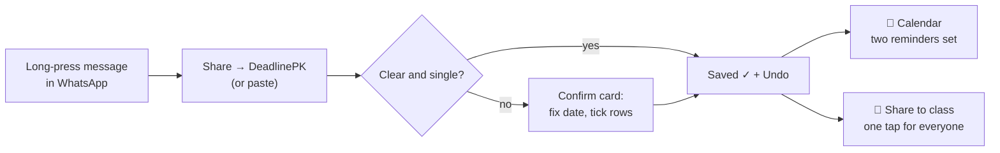

<div align="center">

# 📌 DeadlinePK

**"kal quiz hai"** &nbsp;→&nbsp; **Thu 26 Nov · 09:00** &nbsp;→&nbsp; **a reminder in your phone's own calendar.**

Made for Pakistani students whose deadlines live in WhatsApp class groups.<br>
Roman Urdu · اردو · English &nbsp;·&nbsp; no account &nbsp;·&nbsp; nothing leaves your phone

**[Open the app](https://gi-v.github.io/deadline-pk/)** &nbsp;·&nbsp; [Printable flyer](https://gi-v.github.io/deadline-pk/flyer.html) &nbsp;·&nbsp; [Privacy](https://gi-v.github.io/deadline-pk/privacy.html) &nbsp;·&nbsp; [Changelog](CHANGELOG.md)

</div>

---

## The problem, as a transcript

```text
CS-101 · Section B                                    43 members
─────────────────────────────────────────────────────────────────
Hamza      guys sir ne kaha test aa raha hai
Sir Ahmed  Assignment 3 submit karni hai Friday tak, midnight
CR Ali     [photo] datesheet.jpg
Zara       kal ka test postpone ho gaya, ab next week Tuesday
Hamza      lol
           … 387 more messages …
You        wait, when was the assignment due?
```

Nobody forgets on purpose. The date is just buried. DeadlinePK digs it out the moment you paste or share the message, shows you what it found, and hands it to the calendar app you already trust to wake you up.

## What it actually does

| You paste | It reads | Notes |
|---|---|---|
| `Quiz kal 9 baje` | tomorrow, 09:00 | one tap to save, Undo if it's wrong |
| `Assignment 3 submit karni hai Friday tak, midnight` | Friday, 23:59 | asks you to confirm |
| `aj raat tak form fill kar do` | today, 23:59 | |
| `Class kal cancel hai, make up class Saturday 11 am` | Saturday, 11:00 | the *cancelled* "kal" is ignored |
| `kal ka test postpone ho gaya, ab next week Tuesday` | the new Tuesday | not tomorrow |
| `CS-301 mid term 14th Dec 9am Hall B` | 14 Dec, 09:00, tagged CS301 | course chip + filter |
| `Sir has uploaded the slides on LMS` | **nothing** | says so, saves nothing |
| `Thanks sir, I will submit by tonight` | asks first | chatter never saves silently |

The design rule is simple: **a wrong date is worse than no app.** So the app saves in one tap only when a message is clear and single. Anything ambiguous ("next Thursday"), multi-line, a question, a cancellation or a postponement goes to a confirm card with "Did you mean…?" chips.

## The daily loop (target: 3 taps)



- **Install it** once from Chrome (Android) or Share → Add to Home Screen (iPhone). The icon long-press has a "Paste a message" shortcut, and shows how many things are due.
- **Reminders come from your phone's calendar**, not from this app: a day before and an hour before for timed items, the evening before and the morning of for all-day ones. The app can be closed.
- **Send it to the group.** Every deadline has a WhatsApp share whose link fills the deadline into a classmate's app. One student pins; the whole section is covered.

## Four ways in

| | What | Where |
|---|---|---|
| 📱 **Web app / PWA** | paste, share-target, list, calendar, backup | [gi-v.github.io/deadline-pk](https://gi-v.github.io/deadline-pk/) |
| 💻 **Chrome extension** | 📌 beside every message on WhatsApp Web, right-click pin anywhere | `extension/` (Web Store listing pending) |
| 🖨 **Flyer** | one page with a QR code, in English and Roman Urdu, for class notice boards | [flyer.html](https://gi-v.github.io/deadline-pk/flyer.html) |
| 📄 **Syllabus scanner** | optional: PDFs and photos via your own Claude key | *More tools* in the web app |

## The privacy promise, and how it is enforced

Your list lives in your browser (`localStorage`). There is no server and no account.

- The page ships a strict **Content-Security-Policy**; the code has **no `innerHTML`**, `eval` or `document.write`; links from strangers (`?add=`) are validated field by field.
- Optional Google Calendar sync uses only the `calendar.app.created` scope: it can touch **its own "DeadlinePK" calendar and nothing else.**
- The extension asks for access to `web.whatsapp.com` only. "Any website" is an opt-in setting.
- Scanned in public: Lighthouse (98 accessibility / 100 best practices / 100 SEO), retire.js, eslint-plugin-security, web-ext lint, and an OWASP ZAP baseline + active scan, all clean of real findings. See [CHANGELOG](CHANGELOG.md).

## What it will not do (honest list)

- It does **not** ring on its own when the app is closed. The calendar does. Real push notifications need a server this project deliberately does not have.
- It is **not** tested on real students yet. The parser is checked on ~125 messages I wrote myself (about 94% exact); the misses are mostly deliberate ambiguity. [LAUNCH.md](LAUNCH.md) has the pilot plan.
- iPhone cannot receive Share-from-WhatsApp (Apple limitation); paste works.
- WhatsApp cannot be auto-sent without the paid Business API; the app opens a message and **you** press send.

## Under the hood

```text
shared/deadline-core.js   ← the only source of truth: parser, ICS, share links, Google sync logic
   ├─ copied → extension/core.js          (generated)
   └─ inlined → web/DeadlineSync-PK.html  (generated, one self-contained file, Tailwind compiled in)
web/src/index.template.html   the web UI source
extension/                    Manifest V3: background worker, content script, popup, options
tools/build.mjs               build + QR flyer;   tests/  core · extension (mocked chrome.*) · built web app
```

The parser is deliberately **offline and rule-based**: Roman Urdu day words (`kal`, `parson`, `agla Jumma`), `9 baje` with `subah/shaam/raat`, Urdu-script digits, day-first dates, week-of-semester, `in 3 days / 3 din baad`, plus traps it must not fall for ("chapters 1-3" is not 1 March; "peer review" is not Monday; a cancelled "kal" is not a deadline).

### Run it

```powershell
npm install
npm run build      # icons + extension/core.js + web app + flyer
npm test           # 106 core · 24 extension · 9 web
node tools/serve.mjs   # http://127.0.0.1:5173
```

Load the extension: `chrome://extensions` → Developer mode → **Load unpacked** → pick the `extension/` folder. Built files are committed on purpose, so CI needs no `npm install`; pushes to `main` run the tests and deploy to GitHub Pages (`.github/workflows/pages.yml`).

If WhatsApp's markup changes and the hover 📌 disappears, the selector to update is `div[data-pre-plain-text]` in `extension/content.js`.

### Optional: Google Calendar sync

"Connect Google Calendar" writes to its own calendar through the Calendar API with no server. Put your OAuth **Client ID** (public, not a secret) in `web/config.json` and rebuild. Setup steps are in [LAUNCH.md](LAUNCH.md).

## Roadmap

- [ ] Pilot with ~10 students across 2–3 class groups, then fix the top three complaints
- [ ] Chrome Web Store listing for the extension
- [ ] A short name and a `.pk` domain
- [ ] Real push reminders (small Cloudflare Worker, opt-in)
- [ ] Feedback channel that isn't GitHub

---

<div align="center">

MIT licensed · built in one long conversation with Claude · [LICENSE](LICENSE)

*If it saved you from a missed quiz, send it to your class group.*

</div>
